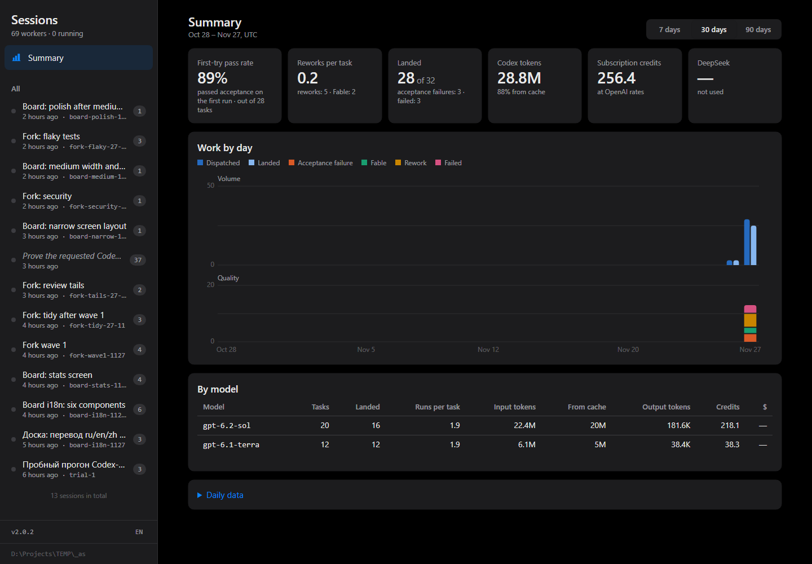
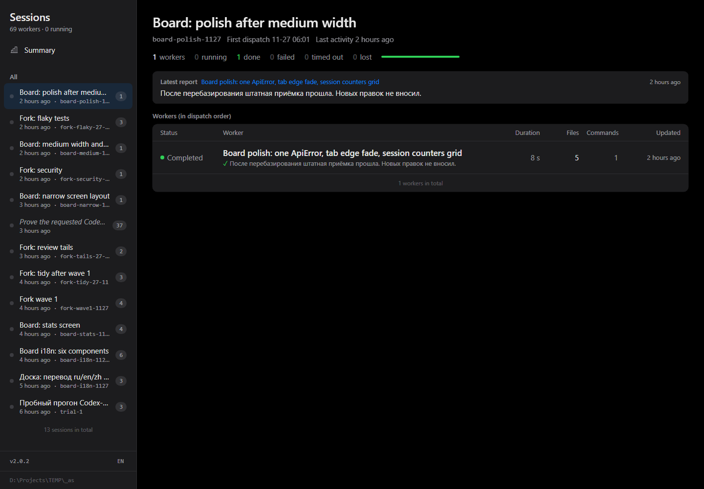
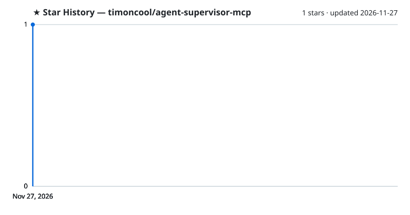

<div align="center">

# agent-supervisor-mcp — Windows fork, localized (Russian, English, Chinese)

**An MCP server that lets Claude Code run many Codex workers in parallel, each in its own git worktree, and land their work only after the tests pass.**

[](LICENSE)
[](https://github.com/timoncool/agent-supervisor-mcp/stargazers)
[](https://github.com/timoncool/agent-supervisor-mcp/commits)
[](https://github.com/zriyox/agent-supervisor-mcp)

**[English](README.md)** · **[Русский](README_RU.md)**



</div>

agent-supervisor-mcp hands coding tasks from Claude Code (or any MCP client) to Codex CLI workers — the lead model plans and reviews, the workers write the code on your ChatGPT subscription. This fork of [zriyox/agent-supervisor-mcp](https://github.com/zriyox/agent-supervisor-mcp) is localized into Russian and built for daily use on Windows: no console windows, a board in English, Russian and Chinese with a Summary of work and cost, a CLI, and stricter acceptance.

## Features

- **Parallel workers without collisions** — one git worktree and branch per worker; `owned_paths` are checked for overlap before a worker starts
- **Acceptance the worker cannot fake** — the server runs your test commands after the worker exits and refuses to land a failed or stale result
- **Small footprint in the lead's context** — worker logs stay on disk; the lead reads a compact summary of every worker (up to 7,000 bytes) and pages through diffs on demand
- **Windows without windows** — worker commands share a hidden console: no flashing terminals, no stolen focus
- **Summary screen** — dispatched, landed, first-try pass rate, rework, Codex tokens and subscription credits per day and per model
- **Board in three languages** — English, Russian, Chinese; picked from the browser, switchable in the footer
- **CLI over the same tools** — `agent-supervisor <tool> --args '<json>'` batches actions in one shell call and always runs the current code
- **Lead decisions on record** — `note_worker` stores the verdict; `review_ok` is refused until acceptance has passed
- **Other providers through Codex** — `model: "deepseek/deepseek-flash"` uses a `model_providers` entry; `reasoning_effort` up to `max`
- **No background self-update** — runners load only from a file you name, never by npm package name

## Quick Start

The package `agent-supervisor-mcp` on npm is the upstream version; this fork installs from the repository. You need Node 22.13+, Git (Git for Windows on Windows) and Codex CLI after `codex login`.

**One message to Claude Code:**

```text
Install the agent-supervisor MCP server from https://github.com/timoncool/agent-supervisor-mcp:
clone it into a folder of your choice, run `npm ci`, `npm --prefix web ci`, `npm run web:build`
and `npm install -g .` there, then run `agent-supervisor-setup` to install the skill and register
the MCP server. Check that `agent-supervisor --help` lists the tools and that `codex login status`
says I am logged in. Remind me to restart Claude Code at the end.
```

**Or by hand:**

1. **Clone**
   ```bash
   git clone https://github.com/timoncool/agent-supervisor-mcp.git
   cd agent-supervisor-mcp
   ```
2. **Install**
   ```bash
   npm ci
   npm --prefix web ci
   npm run web:build
   npm install -g .
   ```
3. **Register** the skill and the MCP server with Claude Code and Codex, then restart Claude Code
   ```bash
   agent-supervisor-setup
   ```

To update: `git pull`, then `npm ci` and `npm run web:build`.

Claude Desktop, Cursor and other MCP clients — the same server in their config (use the folder you cloned into):

```json
{
  "mcpServers": {
    "agent-supervisor": {
      "command": "node",
      "args": ["C:/path/to/agent-supervisor-mcp/src/mcp-server.js"]
    }
  }
}
```

## Usage

Ask Claude Code to delegate: *"split this into tasks and give them to Codex workers"*. The installed skill tells it the loop:

1. `create_worker` — the task, the files the worker may change (`owned_paths`), acceptance commands, model and effort
2. `wait_workers` / `poll_workers` — wait for the batch; the server runs acceptance after each worker exits
3. `get_worker` and `get_worker_diff` — the real commands with exit codes, then the diff
4. `land_worker` — land the accepted work on your branch, or `resume_worker` to send it back with the review

The board runs at `http://127.0.0.1:7877` (`agent-supervisor-web`): every batch, its workers, their reports and events.


 The same tools work from a shell:

```bash
agent-supervisor poll_workers --args '{}'
agent-supervisor --help create_worker
```

## Tools

Fifteen by default; `facts`, `review` and `get_artifact` are added with `AGENT_SUPERVISOR_TOOLS=all`. Full arguments: [tool reference](docs/reference.en.md).

| Tool | What it does |
|---|---|
| `preflight_worker` | Proves the environment with a short probe before a real worker is spent |
| `create_worker` | Starts one worker on one task in its own worktree: files it may change, acceptance, model, effort |
| `resume_worker` | Continues the same worker session with review notes; can rebase it onto newer code first |
| `cancel_worker` | Stops a worker or its acceptance run; its worktree and changes stay |
| `poll_workers` | Compact table of every worker, then only what changed since the last cursor |
| `wait_workers` | Waits until the given workers finish, up to 60 s per call |
| `get_worker` | One worker: status, report, real commands with exit codes, acceptance |
| `get_worker_diff` | What the worker changed: file index, then patches page by page |
| `ask_worker` | A side question to a read-only fork of the worker's thread |
| `land_worker` | Lands the accepted work on your branch; refuses failed or stale acceptance |
| `verify_push` | Proves the landed commit is on the remote branch |
| `cleanup` | Plans and removes worktrees that are safe to remove |
| `find_works` | Finds workers of a session or by text |
| `describe_session` | Records a batch's title, objective and default acceptance |
| `note_worker` | Records the lead's decision; `review_ok` needs passed acceptance |

## Configuration

| Variable | What it does |
|---|---|
| `SUPERVISOR_HOME` | where the state, logs and worktrees live (default: `~/.agent-supervisor`) |
| `CODEX_HOME` | a separate Codex config for the workers: its own login, `AGENTS.md`, model providers |
| `CODEX_BIN` | the Codex executable, when it is not found on `PATH` |
| `AGENT_SUPERVISOR_CLEANUP_HOLD_DAYS` | how long worktrees that were never landed are kept |
| `SUPERVISOR_WEB_PORT` | board port (default `7877`) |
| `AGENT_SUPERVISOR_RUNNER_<NAME>` | path to a runner module other than the built-in `codex` and `claude` |

## How this differs from Claude Code subagents

A subagent can open its own worktree too, so file isolation is not the difference. The model and the process are.

| | Claude Code subagent | agent-supervisor worker |
|---|---|---|
| Which models | Claude only | Anything the Codex CLI has a provider for |
| Who does the work | Claude Code itself | A separate `codex exec` process |
| Two workers writing one file | No path declaration | `owned_paths` overlap is checked before dispatch and rejected |
| The main thread dies | The work cannot be collected | Workers and acceptance run to the end; a new window finds them again with `find_works` |
| Who can drive it | Claude Code only | Any MCP client |
| Seeing the process | Only the conclusion it returns | Raw JSONL and the web board |

## State and uninstall

Everything lives under `SUPERVISOR_HOME` (`~/.agent-supervisor` by default): `data/supervisor.sqlite` is the ledger, `data/runs/<taskId>.jsonl` is Codex's raw output, `worktrees/<taskId>/` holds each worker's checkout. The MCP server and the board must point at the same directory.

```bash
npm uninstall -g agent-supervisor-mcp
claude mcp remove -s user agent-supervisor
codex mcp remove agent-supervisor
rm -rf ~/.claude/skills/agent-supervisor ~/.agents/skills/agent-supervisor ~/.codex/skills/agent-supervisor ~/.agent-supervisor
```

## Troubleshooting

| Symptom | Cause | Fix |
|---|---|---|
| Missing from `claude mcp list` | The server was not registered | `agent-supervisor-setup` |
| Worker `failed` at once, `spawn codex ENOENT` | No codex on the process `PATH` | Set `CODEX_BIN` |
| `codex only resolved to a shell shim` | Windows found only the `.cmd`; the package files are gone | Reinstall `@openai/codex`, or point `CODEX_BIN` at `codex.exe` |
| `Cannot find module 'node:sqlite'` | Node older than 22.13.0 | Upgrade Node |
| Worker is `lost` | The worker or its run process was killed | Read the events, then `resume_worker` |
| Worker is `timed_out` | Its time budget ran out and it was stopped | Read what it left; `resume_worker`, or `followup_of` with new `limits` |
| `git add` fails with `index.lock: Operation not permitted` | The sandbox makes `.git` read-only on purpose | Let `land_worker` commit with `commit_message` |
| `owned_paths overlap with active worker(s)` | Two workers claimed the same paths | Split the work differently, or cancel the one holding them |
| `acceptance_stale` on landing | Acceptance passed on an older base | `resume_worker` with `rebase_onto: "HEAD"` |
| The board is empty | The board and the MCP server use different `SUPERVISOR_HOME` | Point both at the same directory |
| `port 7877 ... is already in use` | A board is already running | Open that one, or change `SUPERVISOR_WEB_PORT` |

## Known limitations

- A worktree is cut from a commit. Uncommitted changes in your checkout are not in it.
- Only the working directory is isolated. Temp directories, databases and ports are shared.
- The guard blocks direct file writes, but it is not a filesystem sandbox: a script you allowed can have side effects outside its declared paths. The diff check before landing is what catches them.
- Acceptance checks what you wrote in `acceptance` and nothing else. The rest is the lead reading the diff.
- The client's MCP tool timeout is a hard wall, so one `wait_workers` call cannot wait to the end. Call it again.

## Documentation

- [Tool reference](docs/reference.en.md) · [Architecture](docs/architecture.md) · [Writing a runner](docs/runner.md)
- Upstream project and its docs: [zriyox/agent-supervisor-mcp](https://github.com/zriyox/agent-supervisor-mcp), [agent-supervisor.zriyo.com](https://agent-supervisor.zriyo.com)

## Other Projects by [@timoncool](https://github.com/timoncool)

| Project | Description |
|---------|-------------|
| [telegram-api-mcp](https://github.com/timoncool/telegram-api-mcp) | Full Telegram Bot API as MCP server |
| [civitai-mcp-ultimate](https://github.com/timoncool/civitai-mcp-ultimate) | Civitai API as MCP server |
| [trail-spec](https://github.com/timoncool/trail-spec) | TRAIL — cross-MCP content tracking protocol |
| [ACE-Step Studio](https://github.com/timoncool/ACE-Step-Studio) | AI music studio — songs, vocals, covers, videos |
| [VideoSOS](https://github.com/timoncool/videosos) | AI video production in the browser |

## Authors

- **zriyo** — original author of [agent-supervisor-mcp](https://github.com/zriyox/agent-supervisor-mcp)
- **Nerual Dreming** — this fork — [Telegram](https://t.me/nerual_dreming) | [neuro-cartel.com](https://neuro-cartel.com) | [ArtGeneration.me](https://artgeneration.me)

## Support the Author

I build open-source software and do AI research. Most of what I create is free and available to everyone. Your donations help me keep creating without worrying about where the next meal comes from =)

**[All donation methods](https://github.com/timoncool/ACE-Step-Studio/blob/master/DONATE.md)** | **[dalink.to/nerual_dreming](https://dalink.to/nerual_dreming)** | **[boosty.to/neuro_art](https://boosty.to/neuro_art)**

- **BTC:** `1E7dHL22RpyhJGVpcvKdbyZgksSYkYeEBC`
- **ETH (ERC20):** `0xb5db65adf478983186d4897ba92fe2c25c594a0c`
- **USDT (TRC20):** `TQST9Lp2TjK6FiVkn4fwfGUee7NmkxEE7C`

## Star History

<a href="https://github.com/timoncool/agent-supervisor-mcp/stargazers">
 <picture>
   <source media="(prefers-color-scheme: dark)" srcset="docs/stars-dark.svg" />
   <source media="(prefers-color-scheme: light)" srcset="docs/stars-light.svg" />
   
 </picture>
</a>

## License

[MIT](LICENSE) — © zriyo; changes in this fork © Nerual Dreming, under the same license.
