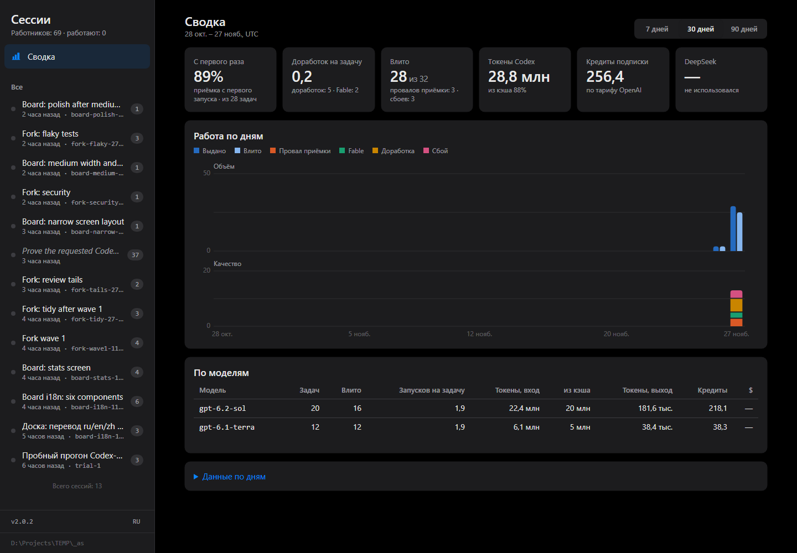
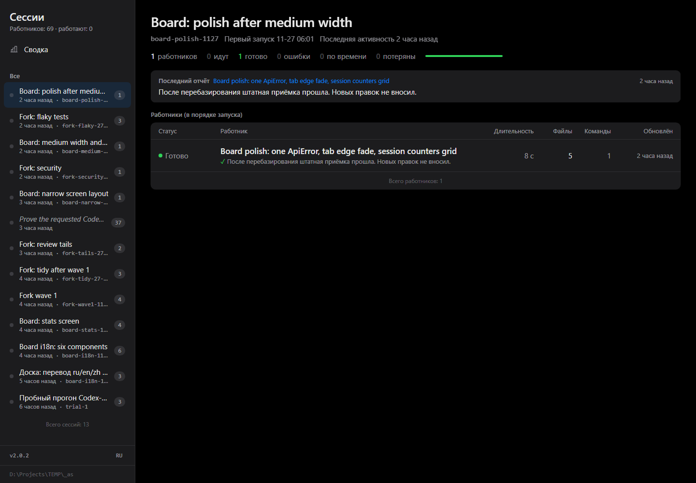
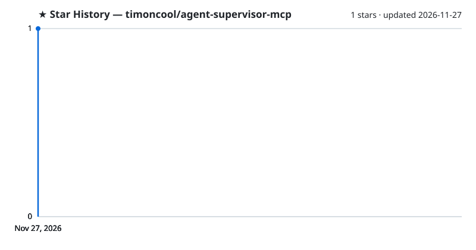

<div align="center">

# agent-supervisor-mcp (форк для Windows)

**MCP-сервер, через который Claude Code раздаёт задачи многим Codex-работникам сразу, каждому в своей git worktree, и вливает их работу только после прохождения тестов.**

[](LICENSE)
[](https://github.com/timoncool/agent-supervisor-mcp/stargazers)
[](https://github.com/timoncool/agent-supervisor-mcp/commits)
[](https://github.com/zriyox/agent-supervisor-mcp)

**[English](README.md)** · **[Русский](README_RU.md)**



</div>

agent-supervisor-mcp отдаёт задачи по коду из Claude Code (или любого MCP-клиента) работникам Codex CLI: ведущая модель планирует и проверяет, а код пишут работники по вашей подписке ChatGPT. Этот форк [zriyox/agent-supervisor-mcp](https://github.com/zriyox/agent-supervisor-mcp) сделан для ежедневной работы на Windows: без консольных окон, с доской на русском, английском и китайском, «Сводкой» по работе и расходам, CLI и более строгой приёмкой.

## Возможности

- **Параллельные работники без столкновений** — у каждого своя git worktree и ветка; пересечение `owned_paths` проверяется до старта
- **Приёмку не подделать** — сервер сам гоняет ваши тесты после работника и не вливает упавшую или устаревшую работу
- **Мало места в контексте ведущего** — логи работников лежат на диске; ведущий читает сжатую сводку по всем работникам (до 7000 байт) и диффы постранично
- **Windows без окон** — команды работников идут в общей скрытой консоли: ничего не мигает и не крадёт фокус
- **Экран «Сводка»** — выдано, влито, доля принятых с первого раза, доработки, токены Codex и кредиты подписки по дням и по моделям
- **Доска на трёх языках** — русский, английский, китайский; язык берётся из браузера и переключается внизу
- **CLI на тех же инструментах** — `agent-supervisor <инструмент> --args '<json>'` делает действия пачкой одним вызовом и всегда запускает свежий код
- **Решения ведущего записываются** — `note_worker` хранит вердикт; «принято» (`review_ok`) нельзя поставить, пока не прошла приёмка
- **Другие провайдеры через Codex** — `model: "deepseek/deepseek-flash"` берёт запись `model_providers`; усилие вплоть до `max`
- **Без фонового автообновления** — раннеры грузятся только из файла, который вы указали, а не по имени npm-пакета

## Быстрый старт

Пакет `agent-supervisor-mcp` в npm — это версия автора, форк ставится из репозитория. Нужны Node 22.13+, Git (на Windows — Git for Windows) и Codex CLI, в который выполнен вход (`codex login`).

**Одним сообщением в Claude Code:**

```text
Install the agent-supervisor MCP server from https://github.com/timoncool/agent-supervisor-mcp:
clone it into a folder of your choice, run `npm ci`, `npm --prefix web ci`, `npm run web:build`
and `npm install -g .` there, then run `agent-supervisor-setup` to install the skill and register
the MCP server. Check that `agent-supervisor --help` lists the tools and that `codex login status`
says I am logged in. Remind me to restart Claude Code at the end.
```

**Или вручную:**

1. **Клонировать**
   ```bash
   git clone https://github.com/timoncool/agent-supervisor-mcp.git
   cd agent-supervisor-mcp
   ```
2. **Установить**
   ```bash
   npm ci
   npm --prefix web ci
   npm run web:build
   npm install -g .
   ```
3. **Подключить** скилл и MCP-сервер к Claude Code и Codex, затем перезапустить Claude Code
   ```bash
   agent-supervisor-setup
   ```

Обновление: `git pull`, затем `npm ci` и `npm run web:build`.

Claude Desktop, Cursor и другие MCP-клиенты — тот же сервер в их конфиге (путь к папке, куда клонировали):

```json
{
  "mcpServers": {
    "agent-supervisor": {
      "command": "node",
      "args": ["C:/path/to/agent-supervisor-mcp/src/mcp-server.js"]
    }
  }
}
```

## Как пользоваться

Попросите Claude Code: *«разбей на задачи и раздай Codex-работникам»*. Установленный скилл описывает ему цикл:

1. `create_worker` — задача, файлы, которые работнику можно менять (`owned_paths`), команды приёмки, модель и усилие
2. `wait_workers` / `poll_workers` — ожидание пачки; после каждого работника сервер сам гоняет приёмку
3. `get_worker` и `get_worker_diff` — реально выполненные команды с кодами выхода, затем дифф
4. `land_worker` — влить принятую работу в вашу ветку, или `resume_worker` — вернуть работнику с замечаниями

Доска открывается на `http://127.0.0.1:7877` (`agent-supervisor-web`): все пачки, их работники, отчёты и события.


 Те же инструменты работают из командной строки:

```bash
agent-supervisor poll_workers --args '{}'
agent-supervisor --help create_worker
```

## Инструменты

Пятнадцать по умолчанию; `facts`, `review` и `get_artifact` добавляются с `AGENT_SUPERVISOR_TOOLS=all`. Все аргументы: [справочник](docs/reference.en.md).

| Инструмент | Что делает |
|---|---|
| `preflight_worker` | Проверяет окружение короткой пробой до запуска настоящего работника |
| `create_worker` | Запускает работника на одну задачу в своей worktree: какие файлы менять, приёмка, модель, усилие |
| `resume_worker` | Продолжает ту же сессию работника с замечаниями; может сперва перебазировать на свежий код |
| `cancel_worker` | Останавливает работника или его приёмку; worktree и правки остаются |
| `poll_workers` | Сжатая таблица всех работников, дальше только изменения с прошлого курсора |
| `wait_workers` | Ждёт, пока работники закончат, до 60 с за вызов |
| `get_worker` | Один работник: статус, отчёт, реально выполненные команды с кодами выхода, приёмка |
| `get_worker_diff` | Что работник изменил: список файлов, затем патчи постранично |
| `ask_worker` | Вопрос в сторону — копии сессии работника только на чтение |
| `land_worker` | Вливает принятую работу в вашу ветку; не вливает упавшую или устаревшую приёмку |
| `verify_push` | Проверяет, что влитый коммит есть в удалённой ветке |
| `cleanup` | Планирует и удаляет worktree, которые можно удалить без потерь |
| `find_works` | Ищет работников сессии или по тексту |
| `describe_session` | Записывает название пачки, цель и приёмку по умолчанию |
| `note_worker` | Записывает решение ведущего; `review_ok` требует пройденной приёмки |

## Настройки

| Переменная | Что делает |
|---|---|
| `SUPERVISOR_HOME` | где лежат состояние, логи и worktree работников (по умолчанию `~/.agent-supervisor`) |
| `CODEX_HOME` | отдельный конфиг Codex для работников: свой вход, `AGENTS.md`, провайдеры моделей |
| `CODEX_BIN` | путь к Codex, если его нет в `PATH` |
| `AGENT_SUPERVISOR_CLEANUP_HOLD_DAYS` | сколько дней хранить невлитые worktree |
| `SUPERVISOR_WEB_PORT` | порт доски (по умолчанию `7877`) |
| `AGENT_SUPERVISOR_RUNNER_<NAME>` | путь к раннеру, кроме встроенных `codex` и `claude` |

## Чем это отличается от сабагентов Claude Code

Сабагент тоже может работать в своей worktree, так что разница не в изоляции файлов, а в модели и процессе.

| | Сабагент Claude Code | Работник agent-supervisor |
|---|---|---|
| Какие модели | Только Claude | Любые, для которых в Codex CLI есть провайдер |
| Кто делает работу | Сам Claude Code | Отдельный процесс `codex exec` |
| Два работника пишут один файл | Пути не объявляются | Пересечение `owned_paths` проверяется до запуска и отклоняется |
| Главная сессия упала | Работу не собрать | Работники и приёмка доходят до конца; новое окно находит их через `find_works` |
| Кто может управлять | Только Claude Code | Любой MCP-клиент |
| Видно ли процесс | Только итоговый ответ | Сырой JSONL и веб-доска |

## Где лежит состояние и как удалить

Всё хранится в `SUPERVISOR_HOME` (по умолчанию `~/.agent-supervisor`): `data/supervisor.sqlite` — учёт работников, `data/runs/<taskId>.jsonl` — сырой вывод Codex, `worktrees/<taskId>/` — рабочие копии. MCP-сервер и доска должны смотреть в одну папку.

```bash
npm uninstall -g agent-supervisor-mcp
claude mcp remove -s user agent-supervisor
codex mcp remove agent-supervisor
rm -rf ~/.claude/skills/agent-supervisor ~/.agents/skills/agent-supervisor ~/.codex/skills/agent-supervisor ~/.agent-supervisor
```

## Если что-то не так

| Симптом | Причина | Что делать |
|---|---|---|
| Нет в `claude mcp list` | Сервер не зарегистрирован | `agent-supervisor-setup` |
| Работник сразу `failed`, `spawn codex ENOENT` | Codex нет в `PATH` процесса | Задать `CODEX_BIN` |
| `codex only resolved to a shell shim` | Windows нашёл только `.cmd`, файлов пакета нет | Переустановить `@openai/codex` или указать `CODEX_BIN` на `codex.exe` |
| `Cannot find module 'node:sqlite'` | Node старше 22.13.0 | Обновить Node |
| Работник `lost` | Работника или его процесс убили | Прочитать события, затем `resume_worker` |
| Работник `timed_out` | Кончился бюджет времени, его остановили | Посмотреть, что осталось; `resume_worker` или `followup_of` с новыми `limits` |
| `git add` падает с `index.lock: Operation not permitted` | Песочница намеренно делает `.git` только для чтения | Пусть коммитит `land_worker` с `commit_message` |
| `owned_paths overlap with active worker(s)` | Два работника заняли одни пути | Разделить работу иначе или отменить того, кто их держит |
| `acceptance_stale` при вливании | Приёмка прошла на устаревшей основе | `resume_worker` с `rebase_onto: "HEAD"` |
| Доска пустая | У доски и MCP-сервера разные `SUPERVISOR_HOME` | Указать обоим одну папку |
| `port 7877 ... is already in use` | Доска уже запущена | Открыть её или сменить `SUPERVISOR_WEB_PORT` |

## Известные ограничения

- Worktree создаётся из коммита: незакоммиченных правок вашей рабочей копии в ней нет.
- Изолирована только рабочая папка. Временные каталоги, базы и порты общие.
- Страж блокирует прямую запись файлов, но это не песочница файловой системы: разрешённый скрипт может задеть что-то за пределами объявленных путей. Это ловит проверка диффа перед вливанием.
- Приёмка проверяет только то, что вы написали в `acceptance`. Остальное — на ведущем, который читает дифф.
- Тайм-аут MCP-инструмента у клиента — жёсткая стена, поэтому один вызов `wait_workers` не дождётся конца. Вызывайте снова.

## Документация

- [Справочник инструментов](docs/reference.en.md) · [Архитектура](docs/architecture.md) · [Как написать раннер](docs/runner.md)
- Исходный проект и его документация: [zriyox/agent-supervisor-mcp](https://github.com/zriyox/agent-supervisor-mcp), [agent-supervisor.zriyo.com](https://agent-supervisor.zriyo.com)

## Другие проекты [@timoncool](https://github.com/timoncool)

| Проект | Описание |
|---------|-------------|
| [telegram-api-mcp](https://github.com/timoncool/telegram-api-mcp) | Telegram Bot API как MCP-сервер |
| [civitai-mcp-ultimate](https://github.com/timoncool/civitai-mcp-ultimate) | Civitai API как MCP-сервер |
| [trail-spec](https://github.com/timoncool/trail-spec) | TRAIL — протокол трекинга контента |
| [ACE-Step Studio](https://github.com/timoncool/ACE-Step-Studio) | AI-студия музыки — песни, вокал, каверы, клипы |
| [VideoSOS](https://github.com/timoncool/videosos) | AI-видеопродакшн в браузере |

## Авторы

- **zriyo** — автор исходного [agent-supervisor-mcp](https://github.com/zriyox/agent-supervisor-mcp)
- **Nerual Dreming** — этот форк — [Telegram](https://t.me/nerual_dreming) | [neuro-cartel.com](https://neuro-cartel.com) | [ArtGeneration.me](https://artgeneration.me)

## Поддержать автора

Я создаю опенсорс софт и занимаюсь исследованиями в области ИИ. Большая часть всего, что я делаю, находится в открытом доступе. Ваши пожертвования позволяют мне создавать и исследовать больше, не отвлекаясь на поиск еды для продолжения существования =)

**[Все способы поддержки](https://github.com/timoncool/ACE-Step-Studio/blob/master/DONATE.md)** | **[dalink.to/nerual_dreming](https://dalink.to/nerual_dreming)** | **[boosty.to/neuro_art](https://boosty.to/neuro_art)**

- **BTC:** `1E7dHL22RpyhJGVpcvKdbyZgksSYkYeEBC`
- **ETH (ERC20):** `0xb5db65adf478983186d4897ba92fe2c25c594a0c`
- **USDT (TRC20):** `TQST9Lp2TjK6FiVkn4fwfGUee7NmkxEE7C`

## Star History

<a href="https://github.com/timoncool/agent-supervisor-mcp/stargazers">
 <picture>
   <source media="(prefers-color-scheme: dark)" srcset="docs/stars-dark.svg" />
   <source media="(prefers-color-scheme: light)" srcset="docs/stars-light.svg" />
   
 </picture>
</a>

## Лицензия

[MIT](LICENSE) — © zriyo; изменения форка © Nerual Dreming, на тех же условиях.
